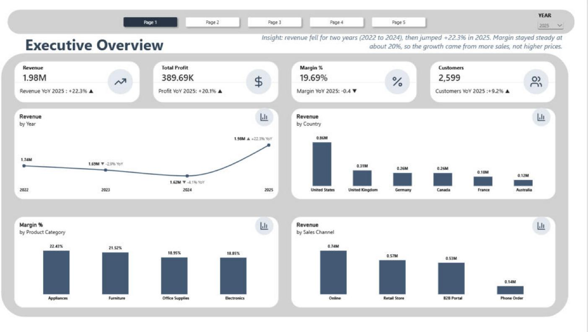
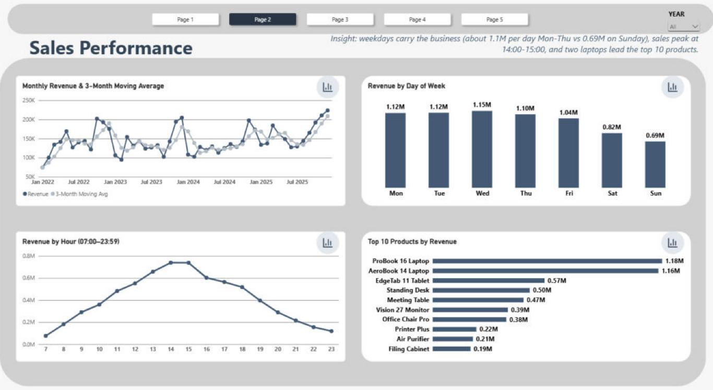
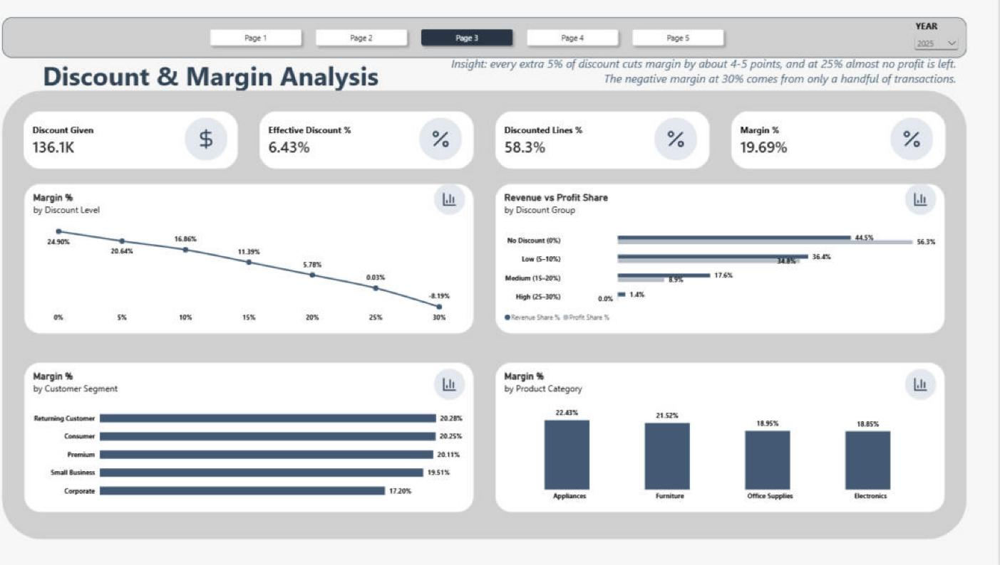
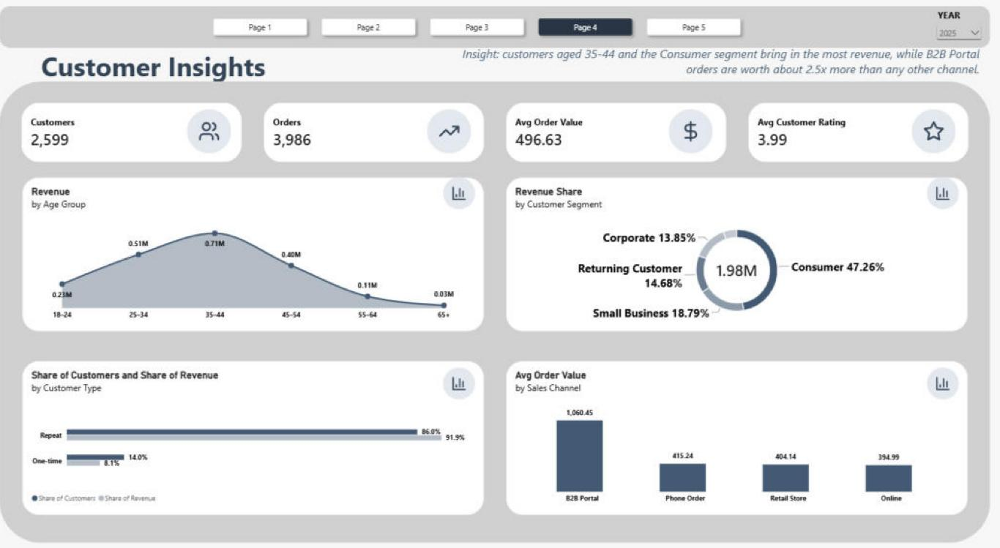
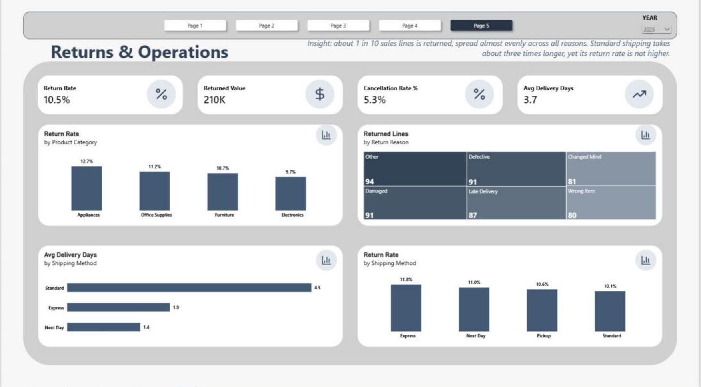
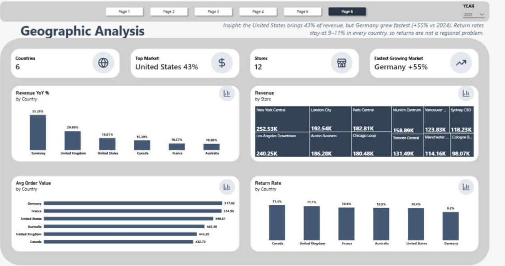

# Retail Sales Dashboard 2022–2025 (Power BI)

Dashboard analisis penjualan ritel multi-negara: kinerja penjualan, efek diskon terhadap margin, profil pelanggan, serta retur dan operasional pengiriman.

**Tools:** Python (pandas) · SQL Server 2025 Express (T-SQL) · SQL Server Management Studio 22 · Power BI Desktop · DAX



---

## 1. Pertanyaan bisnis

1. Bagaimana tren revenue dan profit dari 2022 sampai 2025?
2. Apakah diskon benar-benar mendorong penjualan, atau justru menggerus margin?
3. Siapa pelanggan yang paling bernilai (umur, segmen, channel)?
4. Seberapa besar masalah retur dan pembatalan, dan apakah terkait dengan kategori produk atau metode pengiriman?

## 2. Data

- Sumber: [Retail Sales Dataset](https://www.kaggle.com/datasets/danielsowah123/retail-sales-dataset) oleh Daniel Sowah di Kaggle (lisensi CC0: Public Domain). Data sintetis untuk latihan analitik/BI, berisi `Sales_transactions_2022_2025.csv` dan `sales_data_dictionary.csv`.
- Data mentah: 18.045 baris × 36 kolom, 2022–2025, dengan anomali yang disengaja (duplikat, salah ketik kategori, nilai mustahil, data hilang).
- Semua file ada di folder [`data/`](data/): [`Sales_transactions_2022_2025.csv`](data/Sales_transactions_2022_2025.csv) (mentah), [`sales_data_dictionary.csv`](data/sales_data_dictionary.csv) (kamus kolom), dan [`Sales_transactions_clean.csv`](data/Sales_transactions_clean.csv) (hasil cleaning).
- Setelah cleaning: `Sales_transactions_clean.csv`, 18.000 baris, 37 kolom (ditambah `Status_Return_Conflict`).
- Cakupan: 6 negara, 12 toko, 4 channel penjualan, 4 kategori produk.

## 3. Proses

**a. Cleaning dengan Python (pandas)** ([`python/clean_retail.py`](python/clean_retail.py))
1. Menghapus baris duplikat, lalu memastikan `Transaction_ID` unik.
2. Memperbaiki tipe data (tanggal, integer nullable `Int64`).
3. Menyeragamkan teks kategori (mis. "paypal"/"PayPal", "NRW" → "North Rhine-Westphalia").
4. Memperbaiki nilai mustahil: umur di luar 16–100, `Unit_Price` yang titik desimalnya bergeser, diskon di luar 0–30%, dan quantity ≤ 0 (direkonstruksi dari `Sales_Amount`).
5. Mengisi data hilang hanya jika ada aturan yang pasti (nama produk dari `Product_ID`, atribut pelanggan dari transaksi lain pelanggan yang sama, Pickup = 0 hari). Selebihnya dibiarkan kosong atau diberi label "Unknown".
6. Menghitung ulang `Sales_Amount` dan `Profit` yang tidak konsisten, dengan toleransi pembulatan yang ikut membesar sesuai quantity.
7. Menandai (bukan mengubah) kontradiksi `Return_Flag = Yes` tetapi status bukan *Returned*, di kolom `Status_Return_Conflict`.
8. Validasi akhir dengan `assert`, sehingga script berhenti jika ada aturan yang dilanggar.

**b. Loading & transformasi di SQL Server** ([`sql/01_setup.sql`](sql/01_setup.sql), dijalankan di SSMS 22 pada instance lokal `.\SQLEXPRESS`, database `RetailDB`)
- CSV dimuat dulu ke tabel staging bertipe teks, supaya satu nilai rusak tidak menggagalkan seluruh load.
- Data dikonversi ke tabel bertipe dengan `TRY_CAST(NULLIF(col,'') AS type)` serta constraint (mis. diskon 0–30%, umur 16–100). Setiap tahap diakhiri query pengecekan jumlah baris dan total.
- Dibuat satu definisi **"penjualan valid"** di view `vw_valid_sales`: tanpa order *Cancelled* dan tanpa baris *Return_Flag = Yes* (15.260 baris, total 7,02 jt). Retur diidentifikasi dari `Return_Flag`, bukan `Order_Status`, karena 276 baris berstatus *Completed* tetapi tetap diretur.

**c. Analisis eksploratif dengan SQL** ([`sql/02_analysis.sql`](sql/02_analysis.sql))

Sebelum membuat dashboard, data dieksplorasi dengan 15 query T-SQL yang dikelompokkan ke 5 tema: tren waktu, produk, promosi, channel dan pelanggan, serta retur dan kualitas data. Setiap query berisi pertanyaan bisnis, teknik yang dipakai, hasil, dan insight. Teknik yang dipakai: CTE, `LAG`, window frame (running total, moving average), `RANK`/`ROW_NUMBER` dengan `PARTITION BY`, conditional aggregation, pivot, `ROLLUP`, dan `COUNT(DISTINCT)`.

Beberapa temuan yang hanya muncul dari SQL:

| Query | Temuan |
|---|---|
| D4 · One-time vs repeat | 71% pelanggan adalah *repeat*, dan mereka menghasilkan **92% revenue** dengan belanja per pelanggan 4,6× lipat. |
| C1–C2 · Kode promo | Diskon rata-rata "HOLIDAY20" hanya 6,2%, dan **42% transaksi berkode promo tidak mendapat diskon**. `Promotion_Code` tidak mencerminkan diskon, jadi analisis diskon memakai `Discount_Percentage`. |
| A2 · YoY bulanan | Ke-12 bulan 2025 tumbuh dibanding 2024 (+3% sampai +45%), jadi lonjakan 2025 bersifat menyeluruh. |
| D5 · Segmen × channel | Semua kombinasi *Corporate* memiliki margin terendah (±18%), sejalan dengan diskon rata-ratanya yang tertinggi (7,7%). |
| E2 · Pengiriman vs rating | Rating datar (3,9–4,0) di semua durasi pengiriman. Nilai 5,0 di 10 hari hanya dari 1 rating, jadi itu *noise*. |

<details>
<summary>Contoh query: pelanggan one-time vs repeat</summary>

```sql
WITH customer AS (
    SELECT Customer_ID,
           COUNT(DISTINCT Order_ID) AS orders,   -- satu order bisa berisi beberapa baris
           SUM(Sales_Amount)        AS spend
    FROM dbo.vw_valid_sales
    GROUP BY Customer_ID
)
SELECT CASE WHEN orders = 1 THEN 'One-time' ELSE 'Repeat' END AS customer_type,
       COUNT(*)             AS customers,
       ROUND(AVG(spend), 2) AS avg_spend_per_customer,
       ROUND(100.0 * SUM(spend) / SUM(SUM(spend)) OVER (), 1) AS spend_share_pct
FROM customer
GROUP BY CASE WHEN orders = 1 THEN 'One-time' ELSE 'Repeat' END;
```

| customer_type | customers | avg_spend_per_customer | spend_share_pct |
|---|---|---|---|
| Repeat | 3.342 | 1.934,52 | 92,1 |
| One-time | 1.332 | 416,93 | 7,9 |

</details>

**d. Model data di Power BI**
- Power BI terhubung langsung ke SQL Server (*Import mode*, `Sql.Database(".\SQLEXPRESS", "RetailDB")`) dan mengambil tabel `dbo.sales_transactions` serta view `dbo.vw_valid_sales`.
- Dua tabel fakta: `vw_valid_sales` (penjualan valid) dan `sales_transactions` (semua transaksi, untuk analisis retur dan pembatalan).
- Satu tabel kalender (`Calendar`) yang ditandai sebagai *date table* dan terhubung ke kedua tabel fakta. *Auto date/time* dimatikan.
- Kolom kalkulasi `Customer Type`: *Repeat* jika pelanggan punya lebih dari 1 order valid sepanjang 2022–2025, selain itu *One-time*. Hasilnya sama dengan query SQL D4.
- 47 measure DAX, dikelompokkan per folder (Discount, Customer, Returns & Ops, Trend, Geography), antara lain:
  - `Top Market` dan `Fastest Growing Market`: memakai `TOPN` + `ADDCOLUMNS` untuk mencari negara dengan revenue terbesar dan pertumbuhan YoY tertinggi
  - `Return Rate (Geo) %`: return rate dari tabel semua transaksi yang ikut terfilter negara/toko lewat `TREATAS`
  - `Revenue MA 3M`: rata-rata revenue 3 bulan terakhir dengan `DATESINPERIOD`, sama dengan query SQL A3
  - `Discount Given = [Gross Sales] − [Revenue]`, dengan Gross Sales = Σ(Quantity × Unit_Price)
  - `Revenue Share %` / `Profit Share %` per kelompok diskon
  - `Return Rate (Lines) %` dan `Cancellation Rate %` dari tabel semua transaksi
  - `Revenue YoY Label` untuk label ▲/▼ perubahan tahunan pada grafik

## 4. Isi dashboard

| Halaman | Fokus | Visual utama |
|---|---|---|
| 1. Executive Overview | KPI utama dan tren tahunan | KPI card + YoY, line chart, column chart |
| 2. Sales Performance | Pola waktu dan produk | Revenue bulanan + moving average 3 bulan, revenue per hari dan jam, Top 10 produk |
| 3. Discount & Margin Analysis | Dampak diskon ke margin | Line margin per level diskon, bar revenue vs profit share |
| 4. Customer Insights | Profil pelanggan | Area per kelompok umur, donut per segmen, porsi pelanggan vs revenue (repeat vs one-time) |
| 5. Returns & Operations | Retur, pembatalan, pengiriman | Treemap alasan retur, return rate per kategori dan pengiriman |
| 6. Geographic Analysis | Negara dan toko | Pertumbuhan YoY per negara, treemap revenue per toko, nilai order dan return rate per negara |

Setiap halaman punya satu kalimat **insight** di kanan atas, yang merangkum temuan utama halaman itu. Semua halaman memakai slicer **YEAR** yang tersinkron, kecuali halaman 2 yang membandingkan semua tahun.

## 5. Temuan utama

1. **Revenue turun dua tahun, lalu melonjak.** 1,74 jt (2022) → 1,69 jt → 1,62 jt (2024), lalu naik **+22,3%** ke 1,98 jt di 2025. Margin tetap stabil di kisaran 19,7–20,2%, jadi kenaikan 2025 berasal dari volume, bukan dari harga.
2. **Diskon besar menghabiskan margin.** Margin turun dari **25,1%** tanpa diskon menjadi **6,2%** di diskon 20% dan **0,6%** di diskon 25%. Penjualan dengan diskon ≥20% menyumbang 6,6% revenue tetapi hanya 1,6% profit. Diskon 30% bahkan rugi (−7%), tetapi hanya dari 7 transaksi.
3. **Tanpa diskon = sumber profit terbesar.** Penjualan tanpa diskon menyumbang 44,6% revenue tetapi **56,1% profit**.
4. **Pelanggan inti: umur 35–44 dan segmen Consumer.** Kelompok umur 35–44 menghasilkan 36% revenue, dan segmen Consumer 44%. Pelanggan *repeat* (71% pelanggan) menghasilkan **92% revenue**.
5. **B2B Portal bernilai tinggi per order.** Nilai rata-rata order di B2B Portal sekitar **2,5×** channel lain (±1.026 vs ±400–420).
6. **Retur ±10% dan merata.** Return rate 10,4%, dengan nilai penjualan yang diretur 828 rb (2022–2025). Alasan retur tersebar hampir rata (Late Delivery 331, Wrong Item 317, Damaged 312, Other 311, Defective 302, Changed Mind 300), tanpa satu penyebab dominan. Appliances memiliki return rate tertinggi (±12%).
7. **Pengiriman Standard 2,5–3× lebih lama** (4,5 hari) dibanding Express (1,9) dan Next Day (1,4), tetapi return rate-nya tidak lebih tinggi. Kecepatan pengiriman tidak tampak menjadi penyebab retur.
8. **Amerika Serikat pasar terbesar, Jerman paling cepat tumbuh.** AS menyumbang 43% revenue 2025 dari 4 toko. Jerman tumbuh **+55%** dibanding 2024, jauh di atas negara lain (UK +30%, AS +19%), dan nilai order rata-ratanya tertinggi di 2025 (517). Return rate tiap negara berkisar 9–11%, jadi retur bukan masalah regional. Prancis dan Australia bergantung pada satu toko saja.

## 6. Rekomendasi

- Batasi diskon maksimal **15%**. Di atas itu margin turun di bawah 12%, dan di atas 20% hampir tidak ada profit.
- Fokuskan promosi pada segmen Consumer dan kelompok umur 25–44. Kembangkan B2B Portal karena nilai order-nya paling tinggi.
- Prioritaskan retensi (program loyalitas, penawaran untuk order kedua), karena pelanggan repeat menghasilkan 92% revenue dan belanja 4,6× lebih banyak per orang.
- Pelajari pendorong pertumbuhan di Jerman (Munich Zentrum dan Cologne Business) untuk diterapkan di pasar yang tumbuh lambat seperti Prancis dan Australia.
- Telusuri retur Appliances. Perbaiki juga pencatatan alasan retur: kategori "Other" masih sebesar alasan lain (±17% retur), sehingga datanya kurang informatif.

## 7. Cara membuka

1. Unduh `VISUALISASI.pbix` dan buka dengan **Power BI Desktop** (gratis). Data sudah tersimpan di file, jadi dashboard bisa langsung dilihat tanpa SQL Server.
2. Untuk mengulang proses dari awal:
   1. Jalankan cleaning dari folder `data/` (butuh Python dan pandas). Script membaca dan menulis CSV di folder tempat ia dijalankan:
      ```bash
      cd data
      python ../python/clean_retail.py
      ```
   2. Install SQL Server Express (2016 SP1 atau lebih baru) dan **SQL Server Management Studio**.
   3. Buka `sql/01_setup.sql` di SSMS, ubah path CSV di bagian `BULK INSERT` ke lokasi `data/Sales_transactions_clean.csv` di komputer Anda, lalu jalankan per bagian (PART 0 → PART 4). Setiap bagian punya query *CHECK*: hasilnya harus 18.000 baris di staging dan 15.260 baris di `vw_valid_sales`. Setelah itu, `sql/02_analysis.sql` bisa dijalankan untuk analisis.
   4. Kalau `BULK INSERT` tidak bisa membaca file, gunakan *klik kanan database → Tasks → Import Flat File* ke tabel `dbo.stg_sales`, lalu lanjutkan dari PART 2.
   5. Di Power BI Desktop, jika nama server Anda berbeda: *Transform data → Data source settings → Change Source*, lalu isi nama server Anda dan klik **Refresh**.

## Struktur folder

```
├── README.md
├── VISUALISASI.pbix                 dashboard Power BI
├── data/
│   ├── Sales_transactions_2022_2025.csv   data mentah dari Kaggle
│   ├── sales_data_dictionary.csv          kamus kolom
│   └── Sales_transactions_clean.csv       hasil cleaning
├── python/
│   └── clean_retail.py              cleaning dengan pandas
├── sql/
│   ├── 01_setup.sql                 load, audit, view vw_valid_sales
│   └── 02_analysis.sql              15 query analisis + insight
├── images/                          screenshot dashboard
└── icons/                           ikon untuk KPI card
```

## Screenshot

| | |
|---|---|
|  |  |
|  |  |
|  |  |

